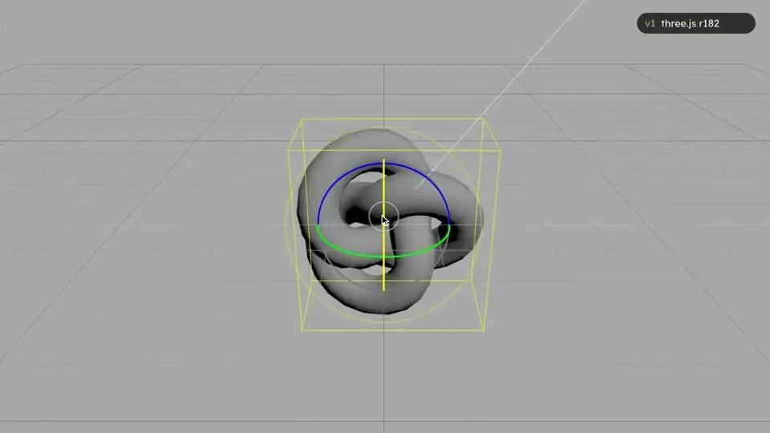

<p align="center">
  <a href="https://vos.so/docs/share/every-release">
    <picture>
      <source media="(prefers-color-scheme: dark)" srcset=".github/assets/lockup-dark.svg">
      
    </picture>
  </a>
</p>

<h3 align="center">Release media on every pull request.</h3>

<p align="center">
  Record the real product in CI, cut the release's videos, verify each one,<br>
  and keep one comment on the pull request with the link.
</p>

<p align="center">
  <a href="https://vos.so/docs/share/every-release">Guide</a>
  &nbsp;·&nbsp;
  <a href="https://github.com/vosjs/skills">Skills</a>
  &nbsp;·&nbsp;
  <a href="https://github.com/vosjs/vos">Engine</a>
  &nbsp;·&nbsp;
  <a href="https://vos.so">vos.so</a>
</p>

<p align="center">
  <a href="https://github.com/vosjs/action/tags"></a>
  <a href="./LICENSE"></a>
</p>

<br>

<a href="https://vos.so/vos/next-release">
  
</a>

<p align="center"><sub>One click script, recorded on three releases of the three.js editor. Each release is a new version of the same video. <a href="https://vos.so/vos/next-release">Watch it with sound</a>.</sub></p>

<br>

## Usage

```yaml
name: release media
on:
  pull_request:
  push:
    tags: ['v*']
permissions:
  contents: read
  pull-requests: write
jobs:
  media:
    runs-on: ubuntu-latest # ships Google Chrome, which mp4 renders need
    steps:
      - uses: actions/checkout@v4
      - uses: actions/setup-node@v4
        with: { node-version: 22 }
      - uses: vosjs/action@v1
        with:
          key: ${{ secrets.VOS_API_KEY }} # mint one at vos.so/app/api
```

> [!TIP]
> Pin the action to a commit in your own workflow (`vosjs/action@<sha> # v1`) and let Dependabot move it. It runs with your job's token and your key, and a floating tag is whatever gets pushed to it next.

## What lands on the pull request

> ### Release media for `pr-42`
>
> **Watch** https://vos.so/vos/… (v3) · **edit** https://vos.so/studio?vos=… · `vos pull` brings studio edits back.
>
> | Channel | Asset | Size | Bytes | Length |
> | --- | --- | --- | --- | --- |
> | github | readme-loop | 1920x1080 | 880 KB | 16.0 s |
> | x | feed-cut | 1920x1080 | 4.1 MB | 42.0 s |
>
> **Verifier:** 0 problems across 2 assets, re-measured from their bytes.

One comment, updated in place: ten pushes leave one comment, not ten. Reviewers sign off on a link instead of pulling the branch, and the same run on a tag is the release.

## What your repo carries

```
media/
  actions.json   the click script, and the next release's too
  doc.json       the signed-off cut (zooms, trims, speed), carried onto new footage
  vos.json       which vos on vos.so the pushes version
  BRAND.md       the brand kit; write it once with `vos brand https://your.app`
```

The [launch-kit skill](https://github.com/vosjs/skills) writes these with you, and the [every-release guide](https://vos.so/docs/share/every-release) walks through it. The action runs what they produced.

## Inputs

| Input | Default | |
| --- | --- | --- |
| `key` | | A vos.so content key. Without one nothing is pushed; the kit and the comment still land. |
| `channels` | `github` | What `vos deliver` renders: `youtube,x,shorts-linkedin,github` or `all`. A cut longer than the take allows is skipped with the reason. |
| `actions` | `media/actions.json` | The click script `vos record` drives. |
| `doc` | `media/doc.json` | The cut to carry onto the new footage. Skipped when absent. |
| `release` | the tag, or `pr-<n>` | The name on the kit and the push label. |
| `tracking` | `media/vos.json` | Which vos the pushes version. The action writes the new base back here; commit it, or the next push is refused as a stale base. |
| `comment` | `true` | Keep the sticky comment (needs `pull-requests: write`). |
| `take` | runner temp | Where the take is recorded. |
| `cli` | this release's | The exact `@vosjs/cli` version it runs, pinned so the job never runs whatever npm served that minute. Each release of the action moves it. |

**Outputs:** `kit`, `vos-id`, `version`, `watch-url`.

## What it refuses

- **A skipped click.** `vos record --strict` fails the job rather than ship around a missing selector.
- **A stale base.** A push against an outdated `vos.json` fails with the changelog of what changed on vos.so.
- **A kit that fails its own check.** `vos validate` fails the job, after the comment says why.

Your files stay yours: the kit is an artifact on the run, never uploaded anywhere for you. This repo runs the action on its own pull requests.

## License

[MIT](./LICENSE). The CLI it installs, [`@vosjs/cli`](https://www.npmjs.com/package/@vosjs/cli), is MIT too.
